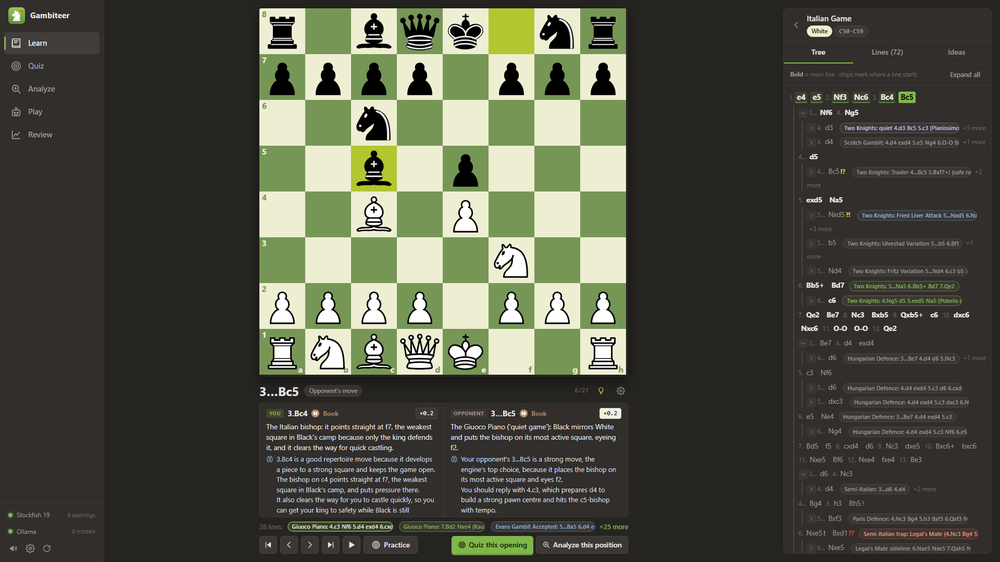
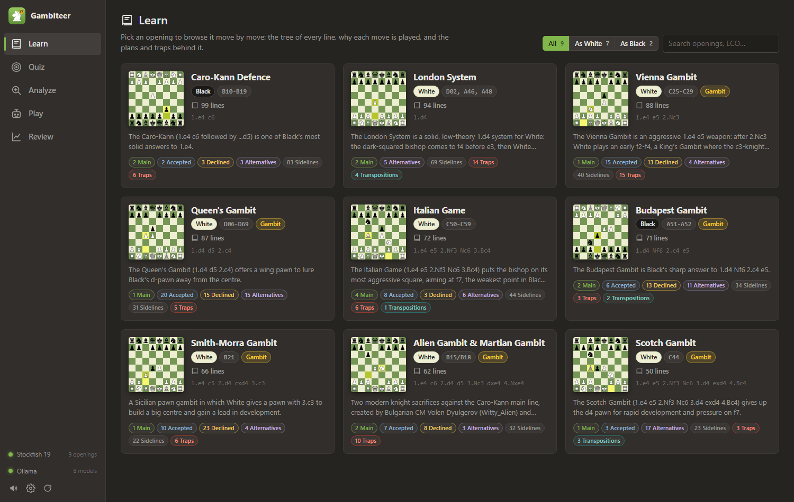
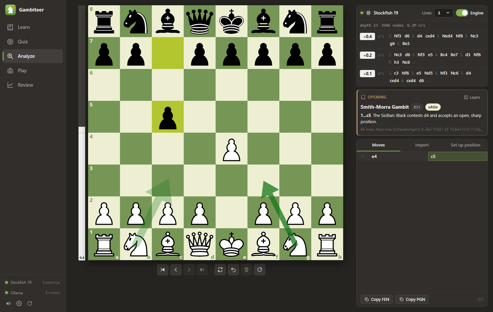
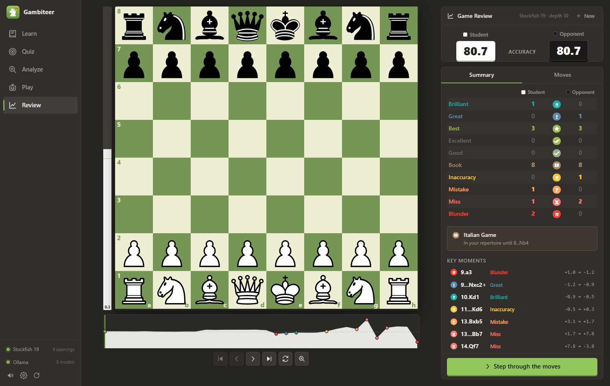

<p align="center">
  
</p>

<h1 align="center">Gambiteer</h1>

<p align="center">
  Learn chess openings line by line, practise them against an opponent that answers from your
  repertoire, and get every move explained by Stockfish 19 and a local AI coach.
</p>

> [!NOTE]
> **This project was made with AI.** The code, the opening research and notes, the logo and this
> documentation were written by [Claude](https://www.anthropic.com/claude) (Anthropic's AI model,
> using Claude Code), directed and tested by [@helloimsean](https://github.com/helloimsean). The
> opening lines were checked with Stockfish, but treat the notes like any study material and use
> your own judgement.

Gambiteer is a local web app with a dark, chess.com-style UI. Everything runs on your own PC: no
accounts, no cloud, no tracking. Stockfish does the chess; a local [Ollama](https://ollama.com)
model turns the engine's facts into plain-language explanations.

<table>
  <tr>
    <td></td>
    <td></td>
  </tr>
  <tr>
    <td></td>
    <td></td>
  </tr>
</table>

## Features

* **Learn**: every opening as a move tree, grouped lines (main, accepted, declined, sidelines,
  traps) and key ideas. Every move has a note on why it is played.
  * **Practice mode**: play your moves on the board and the opponent answers automatically from
    the line you are learning, or with a random variation from your repertoire.
  * **Coach**: every move (yours and the opponent's) gets a Stockfish verdict (Book, Best,
    Inaccuracy, Mistake, Blunder...) and an explanation from your local AI model, from your side of
    the board, including what to play next.
  * Moves outside the repertoire stay on the board: the coach says whether the move is actually
    good or bad compared with the repertoire move, and you can take it back.
* **Quiz**: line drills, position quizzes and trap puzzles from your repertoires. Positions you know
  badly come up more often.
* **Analyze**: a free analysis board with live Stockfish 19 lines (MultiPV 1-5), an eval bar,
  arrows, FEN/PGN import, and a label when the position is in your opening data.
* **Play**: play a bot, optionally from one of your opening lines. Pick your opponent:
  * **Stockfish** is the strongest chess engine, held back to the Elo you choose (400-3190).
  * **Maia** (optional, step 5 of the install) is more human-like: a neural network trained on
    millions of real online games. It plays like a person at that rating, including human-style
    mistakes. See [How bot strength works](#how-bot-strength-works).
  * **Panicfish** is Stockfish 19 at full strength that loses 300 Elo every time you check it. After
    12 checks it has nothing left and plays random moves.
  * **Variants**: pick Crazyhouse, Chess960, King of the Hill, Three-Check, Antichess, Atomic, Horde
    or Racing Kings from the dropdown. Chess960 runs on Stockfish 19; the others need Fairy-Stockfish
    (optional, step 6 of the install). Hint, Review and Analyze are for standard chess only, and
    variant games still appear in History.
* **Review**: chess.com-style game review (brilliant to blunder, accuracy, eval graph), with an AI
  explanation of why each move was good or bad. Press **Play best move**, or play any legal move on
  the board, and Stockfish grades it in a side line under that move.
* **History** (under **More** in the sidebar): every game you finish against a bot, with its Elo, the
  result and, once you have reviewed the game, both players' accuracy. It is saved in your browser.
* **PGN import and export**: paste a PGN or open a `.pgn` file in Analyze and Review, and copy or
  download a game as PGN from either tab.
* **Languages**: Settings > *Language* switches the app and the coach's explanations to English,
  Russian, Spanish, German, French, Portuguese, Italian or Chinese. Opening names and repertoire
  notes stay in English, and how well the coach writes in a language depends on the model.

### Openings included

| Opening | You play | Notes |
|---|---|---|
| Alien Gambit & Martian Gambit | White | knight sacrifices on f7 / e6 against the Caro-Kann, with every decline |
| Italian Game | White | Giuoco Piano, Evans Gambit, Two Knights, quiet lines and traps |
| Vienna Gambit | White | |
| Scotch Gambit | White | |
| Smith-Morra Gambit | White | against the Sicilian |
| Queen's Gambit | White | the d4 opening |
| London System | White | |
| Caro-Kann Defence | Black | against 1.e4 |
| Budapest Gambit | Black | against 1.d4 |

You can add your own (see [Adding an opening](#adding-an-opening)).

## Install (Windows 10/11)

### 1. Install the programs

| Program | Version | Used for |
|---|---|---|
| [Git](https://git-scm.com/download/win) | any | downloading the code |
| [Python](https://www.python.org/downloads/) | 3.12 or newer (tested with 3.14) | the backend |
| [Node.js](https://nodejs.org) | 20.19 or newer (LTS recommended) | building the web interface |
| [Ollama](https://ollama.com/download) | any recent version | the AI explanations (everything else works without it) |
| Stockfish 19 | step 4 below | analysis, bots, review, the coach's verdicts |
| Maia (optional) | step 5 below | the human-like bot |
| Fairy-Stockfish (optional) | step 6 below | seven of the eight variants in **Play** |

The quickest way is `winget` in a PowerShell or Command Prompt window:

```powershell
winget install --id Git.Git -e
winget install --id Python.Python.3.13 -e
winget install --id OpenJS.NodeJS.LTS -e
winget install --id Ollama.Ollama -e
```

If you use the python.org installer instead, tick **"Add python.exe to PATH"**. Close and reopen
your terminal afterwards so the new commands are found. Check with:

```powershell
git --version; python --version; node --version; ollama --version
```

### 2. Download Gambiteer

```powershell
cd $HOME\Documents          # or wherever you want it
git clone https://github.com/helloimsean/gambiteer.git
cd gambiteer
```

### 3. Install the Python and Node packages

```powershell
python -m pip install -r backend\requirements.txt
cd frontend; npm install; cd ..
```

(`start.bat` also runs `npm install` and builds the interface by itself if you skip the second line.)

### 4. Download Stockfish 19

Stockfish is not in the repository (the file is about 100 MB and has its own license). From the
`gambiteer` folder, in PowerShell:

```powershell
$ProgressPreference = 'SilentlyContinue'
Invoke-WebRequest "https://github.com/official-stockfish/Stockfish/releases/download/sf_19/stockfish-windows-x86-64-universal.zip" -OutFile "$env:TEMP\stockfish19.zip"
Expand-Archive "$env:TEMP\stockfish19.zip" -DestinationPath "$env:TEMP\stockfish19" -Force
Copy-Item "$env:TEMP\stockfish19\stockfish\stockfish-windows-x86-64-universal.exe" engines\stockfish19.exe
```

Or download it from <https://stockfishchess.org/download/>, unzip it and save the `.exe` as
`engines\stockfish19.exe`.

### 5. Install Maia, the human-like bot (optional)

Maia is a second bot to play against. Skip this step if Stockfish is enough; you can add Maia at any
time. From the `gambiteer` folder:

```powershell
python tools\install_maia.py
```

This downloads the Leela Chess Zero engine (lc0, CPU build) to `engines\lc0\` and the nine Maia
networks to `engines\maia\`, and checks every file against a pinned SHA-256. Neither is in the
repository. Start Gambiteer (or restart it if it was running) and the Maia card in **Play** is
enabled. `python tools\check_maia.py` tests whether the engine runs on your PC.

lc0 needs the [Microsoft Visual C++ 2015-2022 x64 Redistributable](https://aka.ms/vs/17/release/vc_redist.x64.exe).
Most Windows PCs already have it; install it if Maia reports that lc0 could not start.

### 6. Install Fairy-Stockfish, for the variants (optional)

Stockfish 19 only plays standard chess and Chess960. Fairy-Stockfish plays the other seven variants.
Skip this step if you only want those two. From the `Chess Openings` folder:

```powershell
python tools\install_fairy.py
```

This downloads one file to `engines\fairy\` and checks it against a pinned SHA-256. It is not in the
repository. Restart Gambiteer afterwards. `python tools\check_fairy.py` tests the engine on your PC.

### 7. Download an AI model

Start Ollama (it runs in the system tray after installing), then pull a model:

```powershell
ollama pull gpt-oss:20b     # best explanations; needs a GPU with about 16 GB of VRAM (13 GB download)
ollama pull llama3.2:3b     # small and fast; works on smaller GPUs or the CPU (2 GB download)
```

One model is enough. Gambiteer uses `gpt-oss:20b` when it is installed and otherwise the first
model it finds; you can switch models in Settings.

### 8. Start it

Double-click **`start.bat`**. It builds the interface the first time, starts the backend and opens
<http://localhost:8000> in your browser. Keep the window open while you use the app; close it (or
press Ctrl+C) to stop.

The two dots at the bottom left of the app show whether Stockfish and Ollama were found.

Options can be passed on: `start.bat -Rebuild` (force a rebuild of the interface),
`start.bat -Port 8001` (if port 8000 is taken), `start.bat -NoBrowser`. You can also run
`start.ps1` directly: `powershell -ExecutionPolicy Bypass -File .\start.ps1`.

### Updating

```powershell
git pull
python -m pip install -r backend\requirements.txt
```

`start.bat` rebuilds the interface automatically when the code changed.

## How bot strength works

Elo is a chess rating: the higher it is, the stronger the player. Beginners are around 800, club
players around 1500, and masters 2200 and up.

**Stockfish** is much stronger than any person, so the Elo you choose makes it play worse on
purpose. From 1320 up it uses Stockfish's own Elo limit; below that, a low Skill Level plus random
move mixing approximates the strength.

**Maia** is not a strong engine held back. There are nine separate networks, one for each 100
rating points from 1100 to 1900, and each was trained on Lichess games between players of about
that rating. So **Maia 1500** means "the network trained on Lichess players rated about 1500".
These are Lichess ratings, which are not the same as chess.com or FIDE ratings, and the match is
approximate: the way Gambiteer picks a move from the network has not been calibrated against real
games.

Maia does not search: it picks one of the moves the network expects a player at that rating to
choose, so it can vary and make human-style mistakes. *Bot move time* is therefore only how long it
waits before answering.

**Panicfish** starts with no limit on its strength, which is the "3600". The first check drops it to
3300, and Stockfish's own limiter tops out at 3190, so that is where it plays until it falls lower.
Below 1320 it uses the same move mixing as the Stockfish bot, and at 0 it picks any legal move at
random. A takeback gives the Elo back. Antichess and Racing Kings have no checks, so Panicfish is not
offered there, and in Horde you play the pawns because only Black has a king to check.

Elo means less in the **variants**: Fairy-Stockfish's limiter was not built with them in mind, so
treat the number as a rough guide.

## Development

How it is built (API endpoints, JSON shapes, components, colours) is in
[ARCHITECTURE.md](ARCHITECTURE.md). Backend: FastAPI + python-chess. Frontend: Vite + React 19 +
TypeScript, chessground and chess.js.

Hot reload, in two terminals:

```powershell
# terminal 1: backend with auto-reload
cd backend
python -m uvicorn app.main:app --port 8000 --reload

# terminal 2: Vite dev server
cd frontend
npm run dev                # http://localhost:5173  (proxies /api and /ws to :8000)
```

Open <http://localhost:5173>. <http://localhost:5173/?dev=1> shows a playground with every shared
component and fake data (no backend needed).

Checks:

```powershell
cd backend;  python -m pytest -q        # backend unit + API tests (no Ollama needed)
cd frontend; npm run build              # type-check + production build (must be clean)
cd frontend; npm run check:i18n         # every translation present, placeholders intact
cd frontend; npx playwright install chromium   # once, for the browser checks below
cd frontend; npm run e2e                # full Playwright journey against http://localhost:8000
```

`npm run e2e` (`frontend/e2e/journey.e2e.mjs`) needs the backend on port 8000 with a fresh build,
Stockfish, and Ollama with `llama3.2:3b` (override with the `MODEL` and `DEPTH` environment
variables or a base URL argument). It clicks through all five tabs, fails on any page exception or
console error, and saves screenshots to `frontend/screenshots/`. Each tab also has more detailed
scripts next to its code (`frontend/src/tabs/*/*.e2e.mjs`, `*.check.mjs`).

## Adding an opening

Each opening is one JSON file in `data\openings\<id>.json`. The full schema is in the docstring of
[`tools/validate_opening.py`](tools/validate_opening.py). In short:

```jsonc
{
  "id": "my-opening",                  // must equal the file name
  "name": "My Opening",
  "side": "white",                     // the side YOU play: "white" or "black"
  "eco": "C50", "family": "1.e4 e5 ...",
  "summary": "2-5 sentences (at least 80 characters).",
  "keyIdeas": ["...", "...", "..."],   // 3-8 items
  "typicalPlans": [], "commonMistakes": [], "sources": ["https://..."],
  "lines": [
    { "id": "main", "name": "Main line", "category": "main",
      "description": "When this arises and what the plan is.", "evaluation": "=",
      "moves": [ { "san": "e4", "why": "Takes the centre.", "nag": "" }, ... ] }
  ]
}
```

Every line starts from the initial position and needs at least 6 plies. At least one line must have
category `main`. Each position needs at least one non-empty `why` somewhere in the file.
Categories: `main | accepted | declined | sideline | trap | transposition | alternative`. Mark
deliberate mistakes with a `nag` (`?`, `??`, `?!`) so the coach explains them as mistakes.

Validate before using it:

```powershell
python tools\validate_opening.py data\openings\my-opening.json           # errors -> exit code 1
python tools\validate_opening.py data\openings\my-opening.json --fix     # canonical SAN (O-O, +, #) + formatting
python tools\validate_opening.py data\openings\my-opening.json --engine  # Stockfish sanity check of every move
```

The backend notices new, changed or deleted files in `data\openings` (it checks at most once a
second), so just reload the page. Files that fail to load are skipped and the reason is logged in
the backend window.

To find opponent replies your file does not cover yet:

```powershell
python tools\check_coverage.py data\openings\my-opening.json --min-ply 2 --engine
python tools\check_coverage.py data\openings\my-opening.json --min-ply 2 --explorer   # needs a Lichess token, see below
```

### Lichess API token (only for `check_coverage.py --explorer`)

`--explorer` asks the Lichess opening explorer how often real players choose each reply. It needs
a free personal API token:

1. Log in at <https://lichess.org> and open <https://lichess.org/account/oauth/token>.
2. Click **+**, give it a description such as `gambiteer`, leave every scope unticked, and click
   **Create**. Copy the token (it starts with `lip_`); Lichess shows it only once.
3. Save it as the only content of a file named `.lichess_token` in the project root (this file is
   in `.gitignore`), or set it for the session: `$env:LICHESS_TOKEN = "lip_..."`.

Treat the token like a password; revoke it on the same page if it leaks. Explorer answers are
cached in `data\_cache\explorer`.

## Changing the AI model

* **In the app**: Settings (the gear at the bottom left) > *Explanation model*, or the model picker
  in the Review tab. "Backend default" lets the backend choose.
* **Backend default**: `gpt-oss:20b` if it is installed, otherwise the first installed model.
  Override it before starting: `$env:OLLAMA_MODEL = "llama3.2:3b"; .\start.bat`
* **More models**: `ollama pull <name>` (for example `qwen2.5:7b`), then reload the page.
* Ollama on another PC: `$env:OLLAMA_URL = "http://other-pc:11434"`.

Small models answer quickly but phrase things loosely; `gpt-oss:20b` gives better explanations but
needs a strong GPU. The explanations are built only from facts computed by Stockfish and
python-chess, but any model can still get a detail wrong. The badges and evaluations always come
from Stockfish.

Other backend settings (environment variables): `STOCKFISH_PATH`, `LC0_PATH`, `MAIA_WEIGHTS_DIR`,
`DATA_DIR`, `FRONTEND_DIST`.
Threads, hash sizes and depths are in `backend/app/config.py` (see `backend/README.md`).

## Troubleshooting

| Symptom | Fix |
|---|---|
| `python`, `node` or `ollama` is "not recognized" | Close and reopen the terminal after installing. For Python, reinstall with "Add python.exe to PATH" ticked. |
| `start.bat` window closes at once | Run it from a terminal (`.\start.bat`) to read the error. |
| "Port 8000 is already in use" | Another program uses the port. Close it, or run `start.bat -Port 8001`. |
| `Python packages are missing` | `python -m pip install -r backend\requirements.txt` |
| Page says `frontend not built` | `start.bat -Rebuild`, or `npm run build` in `frontend`. |
| Old interface after an update | `start.bat -Rebuild`, then reload the browser with Ctrl+F5. |
| Stockfish dot is red / "engine unavailable" | Check that `engines\stockfish19.exe` exists (step 4) or set `STOCKFISH_PATH`. Antivirus tools sometimes quarantine engines. |
| Maia card says "Not installed", or "Bot move failed: Maia is unavailable" | Run `python tools\install_maia.py` (step 5), then restart Gambiteer. `python tools\check_maia.py` shows what is wrong with the engine. If it says lc0 could not start, install the [Microsoft Visual C++ 2015-2022 x64 Redistributable](https://aka.ms/vs/17/release/vc_redist.x64.exe). Antivirus tools sometimes quarantine engines. |
| A variant says it needs Fairy-Stockfish, or "Bot move failed: Fairy-Stockfish ..." | Run `python tools\install_fairy.py` (step 6), then restart Gambiteer. `python tools\check_fairy.py` shows what is wrong with the engine. Antivirus tools sometimes quarantine engines. |
| "Bot move failed: Maia stopped unexpectedly" | Press **Retry**: the next move starts a fresh engine. If it keeps happening, run `python tools\check_maia.py`, then `python tools\install_maia.py` to repair the install. |
| Ollama dot is red / "Coach unavailable" | Start Ollama (tray app, or `ollama serve`) and check that `ollama list` shows a model. Then click the refresh icon at the bottom left. |
| Explanations are slow | Use a smaller model (`llama3.2:3b`). The first request after loading a model is the slowest. |
| A new opening does not appear | Run `tools\validate_opening.py` on it; the backend log says why a file was skipped. |
| `npm run dev`: "Port 5173 is in use" | Another Vite server is running. Close it (the port is fixed because of the CORS settings). |
| `check_coverage.py --explorer`: `401 Unauthorized` | Add a Lichess token (see above). |

## Project layout

```
start.bat               double-click to start (runs start.ps1)
LICENSE                 GNU GPL v3
start.ps1               build the interface if needed, start the backend on :8000, open the browser
ARCHITECTURE.md         contracts: endpoints, JSON shapes, components, colours, file layout
backend/                FastAPI + python-chess (app/, tests/)            -> backend/README.md
frontend/               Vite + React + TypeScript, chessground, chess.js  -> frontend/README.md
  public/logo.svg       the Gambiteer logo
  e2e/journey.e2e.mjs   full end-to-end user journey (Playwright)
data/openings/          opening repertoires (JSON)
tools/                  validate_opening.py, check_coverage.py, install_maia.py, check_maia.py, install_fairy.py, check_fairy.py
engines/                stockfish19.exe, lc0/ + maia/ for Maia, fairy/ for the variants (none in git)  -> engines/README.md
docs/screenshots/       pictures used in this README
```

## Contributors

* **[@helloimsean](https://github.com/helloimsean)**: idea, direction, testing.
* **[Claude](https://www.anthropic.com/claude)** (Anthropic, via Claude Code): code, opening
  research and notes, logo and documentation.

## License

Copyright (C) 2026 helloimsean

Gambiteer is free software: you can redistribute it and/or modify it under the terms of the
[GNU General Public License](LICENSE) as published by the Free Software Foundation, either version 3
of the License, or (at your option) any later version. It is distributed in the hope that it will
be useful, but WITHOUT ANY WARRANTY; without even the implied warranty of MERCHANTABILITY or FITNESS
FOR A PARTICULAR PURPOSE. See [LICENSE](LICENSE) for the full text.

## Third-party software

Gambiteer uses [Stockfish](https://stockfishchess.org) (GPLv3, downloaded separately),
[python-chess](https://github.com/niklasf/python-chess) (GPLv3),
[chessground](https://github.com/lichess-org/chessground) (GPLv3),
[chessops](https://github.com/niklasf/chessops) (GPLv3), [chess.js](https://github.com/jhlywa/chess.js) (BSD-2-Clause), [FastAPI](https://fastapi.tiangolo.com)
(MIT), [React](https://react.dev) (MIT), [Vite](https://vite.dev) (MIT) and
[Ollama](https://ollama.com) (MIT). Opening statistics come from the
[Lichess opening explorer](https://lichess.org/analysis#explorer).

The variants other than Chess960 run on [Fairy-Stockfish](https://github.com/fairy-stockfish/Fairy-Stockfish)
(GPL-3.0), downloaded separately by `tools/install_fairy.py`.

The queen and rook sacrifice voice lines in **Review** are by Levy Rozman
([GothamChess](https://www.youtube.com/@GothamChess)).

The optional human-like bot runs the [Maia](https://github.com/CSSLab/maia-chess) networks (GPL-3.0)
inside [Leela Chess Zero](https://github.com/LeelaChessZero/lc0) (lc0, GPL-3.0). Both are downloaded
separately by `tools/install_maia.py`. Maia comes from this paper:

> Reid McIlroy-Young, Siddhartha Sen, Jon Kleinberg and Ashton Anderson. "Aligning Superhuman AI with
> Human Behavior: Chess as a Model System". *Proceedings of the 26th ACM SIGKDD International
> Conference on Knowledge Discovery and Data Mining* (KDD 2020).
